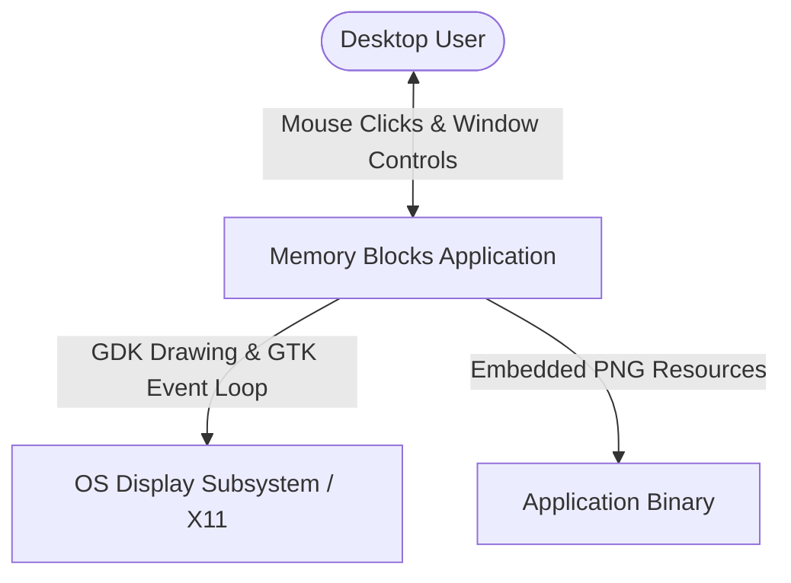
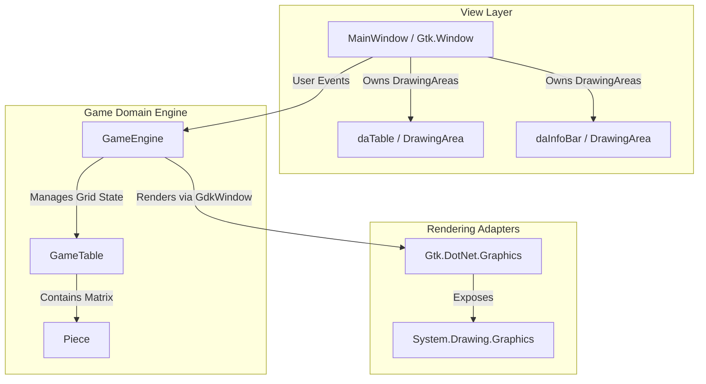
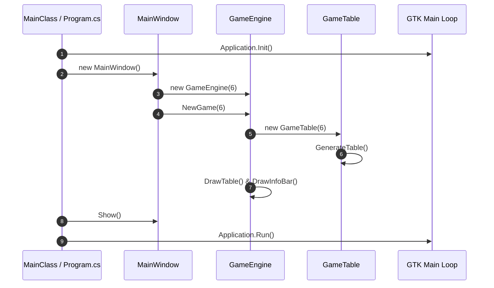
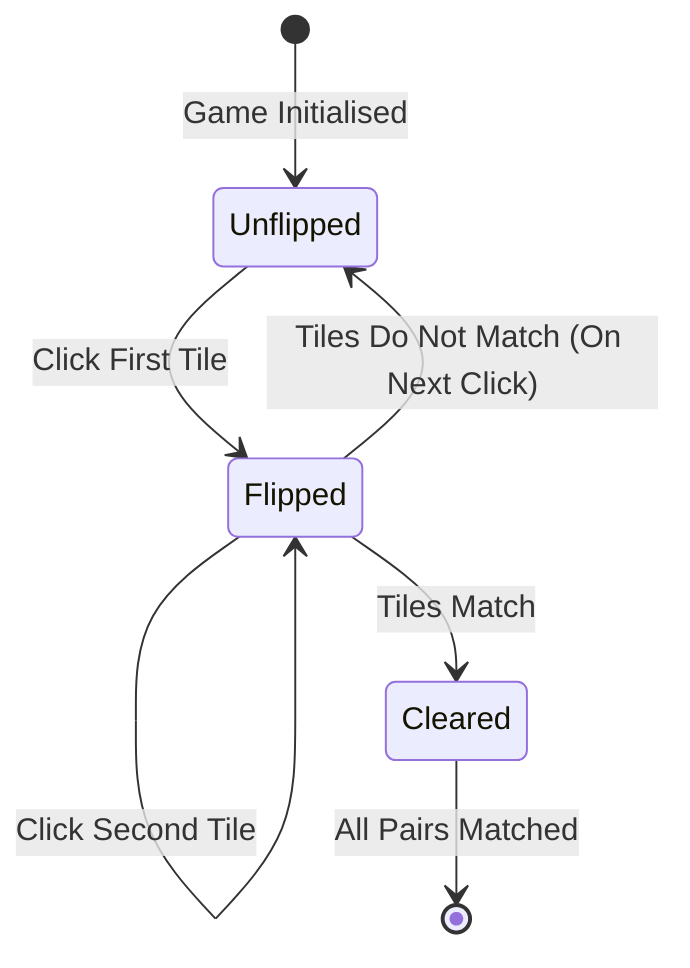
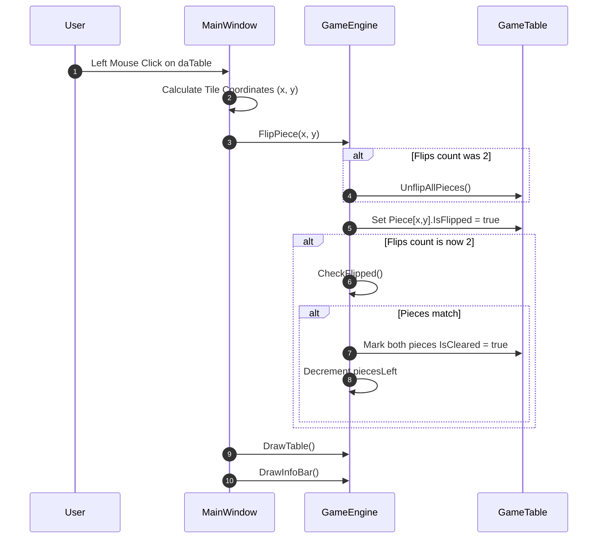
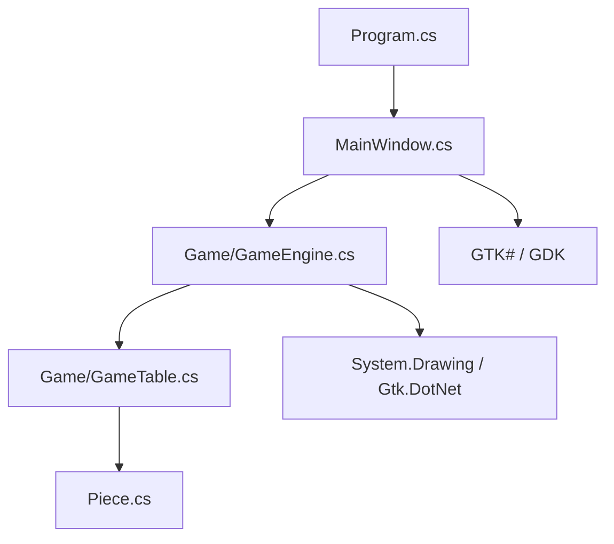

# Memory Blocks Architecture

This document describes the software architecture of Memory Blocks, a desktop tile-matching puzzle game implemented in C# targeting Mono and GTK# 2.12.

## 📑 Table of Contents

- [Purpose](#purpose)
- [System Context](#system-context)
- [Architectural Style](#architectural-style)
- [Runtime Flow](#runtime-flow)
- [Components](#components)
- [Architectural Areas](#architectural-areas)
- [Data Architecture](#data-architecture)
- [Interfaces and Integrations](#interfaces-and-integrations)
- [Key Flows](#key-flows)
  - [Tile Flip and Match Evaluation](#tile-flip-and-match-evaluation)
- [Cross-Cutting Concerns](#cross-cutting-concerns)
  - [Security and Privacy](#security-and-privacy)
  - [Error Handling](#error-handling)
  - [Observability](#observability)
  - [Configuration](#configuration)
  - [Concurrency and Resource Use](#concurrency-and-resource-use)
- [Dependency Direction and Rules](#dependency-direction-and-rules)
- [External Dependencies](#external-dependencies)
- [Deployment and Operations](#deployment-and-operations)
- [Compatibility Contracts](#compatibility-contracts)
- [Testing and Verification](#testing-and-verification)
- [Design Constraints](#design-constraints)
- [Source Map](#source-map)
- [Related Documentation](#related-documentation)

## 🎯 Purpose

Memory Blocks is a local desktop tile-matching puzzle game. This document defines the application's software structure, component boundaries, execution lifecycle, rendering mechanism, and architectural constraints to guide maintainers and contributors.

## 🌐 System Context

Memory Blocks operates entirely on the user's local system as a standalone desktop application. It does not connect to external networks, persistent databases, or remote web services.



The principal external boundaries are:
- **OS Display Subsystem / GTK# Engine:** The application interacts with GTK# 2.12 and GDK drawing surfaces to render the user interface and receive input events.
- **Embedded Resources:** Card piece graphics and application icons are stored as embedded assembly resources compiled directly into the binary.

## 🏗️ Architectural Style

Memory Blocks follows an event-driven Model-View-Presenter (MVP) / Model-View-Controller (MVC) architectural style suitable for GTK-based desktop applications.



The principal architecture boundaries are:
- **View Layer (`MainWindow` & GTK Widgets):** Handles window creation, user menu actions, click event translation, modal dialog display, and window layout management.
- **Game Engine (`MemoryBlocks.Game.GameEngine`):** Orchestrates the game session state, timer, score state, turn logic, and GDK GDI+ rendering.
- **Game Domain Model (`GameTable` & `Piece`):** Represents the grid geometry, piece randomisation algorithm, piece matching state, and individual tile attributes.

## 🔄 Runtime Flow



The principal runtime sequence is:
1. `MainClass.Main` initialises GTK# using `Application.Init()`.
2. `MainWindow` constructs the UI components and instantiates `GameEngine` with an initial 6x6 grid.
3. `GameEngine.NewGame` instantiates a `GameTable`, randomises piece values, resets game time and counters, and triggers initial drawing.
4. `Application.Run()` starts the GTK main event loop, waiting for user interactions and timer tick callbacks.

## 🧩 Components

| Component | Responsibility | Principal Dependencies | Lifetime or Ownership |
|-----------|----------------|------------------------|-----------------------|
| `MainClass` | Application entry point and GTK initialization. | `Gtk.Application`, `MainWindow` | Ephemeral (main thread entry) |
| `MainWindow` | Top-level window, menu bar dispatcher, and GDK event binding. | `Gtk.Window`, `GameEngine`, `DrawingArea` | Application runtime lifetime |
| `GameEngine` | Session state, timer loop, game rule validation, and System.Drawing rendering. | `GameTable`, `Gdk.Window`, `Gtk.DotNet.Graphics` | Owned by `MainWindow` |
| `GameTable` | Tile board data structure and random pair distribution logic. | `Piece[,]`, `System.Random` | Created per game session by `GameEngine` |
| `Piece` | Data model representing an individual board tile value and state. | None | Owned by `GameTable` matrix |

## 🗂️ Architectural Areas

### Game Domain & Logic

Paths:
- `MemoryBlocks/Game/GameEngine.cs`
- `MemoryBlocks/Game/GameTable.cs`
- `MemoryBlocks/Game/Piece.cs`

Responsibilities:
- Game state tracking (pieces left, flips count, game timer, completed status).
- Random matching pair generation and placement algorithm.
- Tile flip and matching verification rules.
- Rendering game grid tiles and information status bar onto GDK drawing surfaces.

Boundary rules:
- Must not depend on specific windowing layout code; operates on generic `Gdk.Window` reference surfaces.

### UI & Presentation

Paths:
- `MemoryBlocks/MainWindow.cs`
- `MemoryBlocks/Program.cs`
- `MemoryBlocks/gtk-gui/`

Responsibilities:
- GTK Application lifecycle management.
- Window widget hierarchy (menu bar, info bar drawing area, game table drawing area).
- Converting pixel coordinate mouse clicks into board grid tile index coordinates.
- Menu action dispatching (difficulty level selection, game retry, about dialog).

Boundary rules:
- Delegates all game state logic and tile verification to `GameEngine`.

## 💾 Data Architecture

Memory Blocks is an in-memory game application and does not persist game data to disk or databases.



| Data or Store | Owner | Representation and Storage | Lifecycle or Consistency |
|---------------|-------|----------------------------|--------------------------|
| Game Board State | `GameTable` | Two-dimensional array (`Piece[,]`) in RAM | Re-allocated on `NewGame` |
| Tile Properties | `Piece` | Object fields (`Value`, `IsFlipped`, `IsCleared`) | Mutable during session |
| Embedded Assets | Assembly | Embedded PNG resources in `MemoryBlocks.exe` | Read-only static assembly resources |

## 🔌 Interfaces and Integrations

| Interface or Integration | Direction | Contract | Owner | Failure Semantics |
|--------------------------|-----------|----------|-------|-------------------|
| GTK# 2.12 Event Loop | Inbound / Bidirectional | C# Delegates & GDK Event Masks (`ButtonPressMask`, `ExposeEvent`) | `MainWindow` | Unhandled exceptions terminate process |
| Gtk.DotNet Graphics Adapter | Outbound | `Gtk.DotNet.Graphics.FromDrawable(Gdk.Window)` | `GameEngine` | Surface drawing errors degrade visually |

## 🔀 Key Flows

### Tile Flip and Match Evaluation



When a user clicks on the game table, `MainWindow` translates the mouse coordinates into grid column and row indices and invokes `FlipPiece(x, y)` on `GameEngine`. If two tiles are flipped, `GameEngine` evaluates whether their values match. If they match, both tiles are marked as cleared; if not, they remain visible until the next flip action unflips them.

## 🧵 Cross-Cutting Concerns

### Security and Privacy

- **Privacy:** Memory Blocks collects, transmits, and persists no personal data or metrics.
- **Trust Boundary:** Runs entirely within the local user process space without elevated privileges or network capabilities.

### Error Handling

- GTK window deletion event gracefully terminates the GTK main loop via `Application.Quit()`.
- Invalid tile coordinates or cleared tile clicks are safely ignored within `GameEngine`.

### Observability

- No external logging framework is used. Diagnostic messages use console output if enabled during debugging.

### Configuration

| Configuration Area | Source | Responsibility | Override or Secret Policy |
|--------------------|--------|----------------|---------------------------|
| Grid Size / Difficulty | In-memory UI Menu | Sets table size (4x4 Easy, 6x6 Moderate, 8x8 Hard) | Volatile session setting |
| Board Colors | `GameEngine` Constructors | Defines background and tile drawing colors | Built-in C# `System.Drawing.Color` defaults |

### Concurrency and Resource Use

- Execution is driven single-threaded by the main GTK GUI thread.
- Time tracking uses GLib timeout callbacks (`GLib.Timeout.Add(1000, TimerTick)`), maintaining timer execution on the main loop.
- Drawing resources (`Graphics` instances created via `Gtk.DotNet`) are explicitly disposed (`gfx.Dispose()`) after each redrawing cycle.

## 🧭 Dependency Direction and Rules



The principal dependency rules are:
- High-level windowing code (`MainWindow`) depends on the game domain engine (`GameEngine`).
- Domain entities (`GameTable`, `Piece`) do not depend on GTK# widgets or GUI windowing references.
- `GameEngine` interacts with GDK drawing surfaces purely through `Gdk.Window` references and `System.Drawing`.

## 📦 External Dependencies

| Dependency | Responsibility | Integration Boundary | Architectural Consequence |
|------------|----------------|----------------------|---------------------------|
| Mono Runtime / .NET 4.5 | Execution environment | System runtime | Cross-platform desktop support on Linux |
| GTK# 2.12 (`gtk-sharp`, `gdk-sharp`, `glib-sharp`) | Windowing framework, widgets, and main event loop | Native GTK2 binding wrapper | Standard desktop look-and-feel on Linux |
| `gtk-dotnet` | Bridging GDK drawables with `System.Drawing.Graphics` | `Gtk.DotNet.Graphics.FromDrawable` | Enables System.Drawing GDI+ rendering calls on GTK drawing areas |

## 🚀 Deployment and Operations

| Concern | Current Design | Architectural Consequence |
|---------|----------------|---------------------------|
| Deployment Model | Standalone compiled executable binary (`MemoryBlocks.exe`) | Requires Mono runtime and GTK# 2.12 installed on target machine |
| Process Topology | Single local GUI process | Minimal CPU/memory consumption; no background daemons |
| Persistence | Purely in-memory | Application state resets upon exit |

## 🛡️ Compatibility Contracts

| Contract | Owner | Invariant | Verification | Change Policy |
|----------|-------|-----------|--------------|---------------|
| Target Framework | `MemoryBlocks.csproj` | .NET Framework 4.5 / Mono profile | Build check via MonoDevelop / xbuild | Maintained for Mono GTK# compatibility |
| Resource Naming | Assembly resources | `MemoryBlocks.Resources.Pieces.piece{ID}.png` naming format | Runtime resource loading during rendering | Resource IDs match values generated by `GameTable` |

## ✅ Testing and Verification

Verification is currently conducted through manual execution and UI testing.

Execute the principal build and run verification with:

```bash
xbuild MemoryBlocks.sln
```

## ⚠️ Design Constraints

- **GTK2 / GTK# 2.12 Binding:** Built specifically around GTK2 and Mono's GTK# bindings (`gtk-sharp-2.0`).
- **Single-Threaded Timer:** Relies on GLib event loop timers rather than system thread timers to avoid cross-thread UI marshaling.

## 🗺️ Source Map

| Area | Path |
|------|------|
| Solution & Project Files | `MemoryBlocks.sln`, `MemoryBlocks/MemoryBlocks.csproj` |
| Application Entry | `MemoryBlocks/Program.cs` |
| UI & Windowing | `MemoryBlocks/MainWindow.cs`, `MemoryBlocks/gtk-gui/` |
| Game Domain & Logic | `MemoryBlocks/Game/` |
| Graphics & Resources | `MemoryBlocks/Resources/` |

## 📚 Related Documentation

- [README.md](./README.md) - Project overview, features, requirements, build and run instructions.
- [CONTRIBUTING.md](./CONTRIBUTING.md) - Guidelines for reporting issues and contributing code.
- [PRIVACY.md](./PRIVACY.md) - Information regarding privacy and data handling.
- [SECURITY.md](./SECURITY.md) - Security policy and vulnerability disclosure procedures.